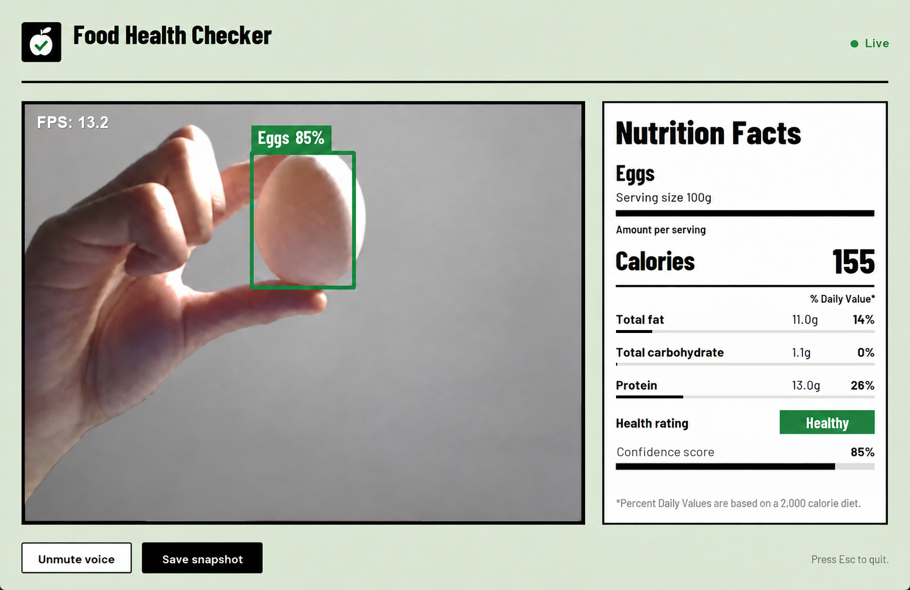
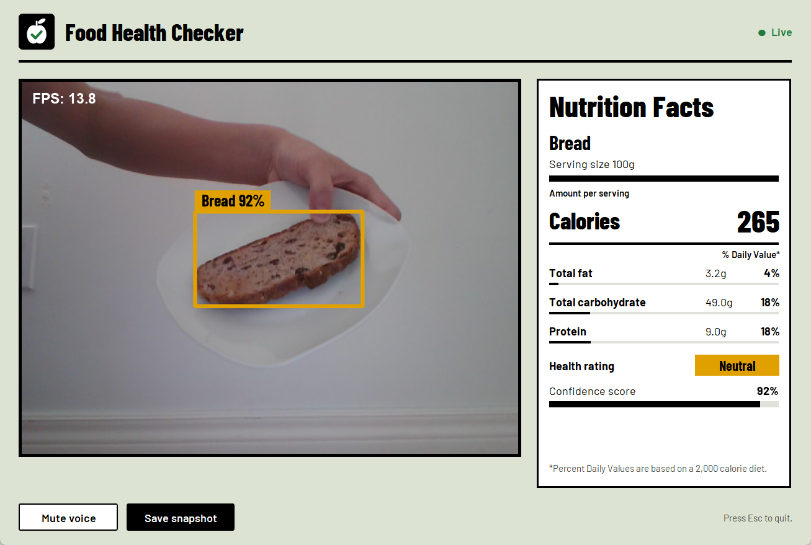

# Computer Vision Food Recognition and Nutritional Analysis System

A Python desktop application that uses a custom YOLO11 model and OpenCV to recognize food in a live webcam feed. It draws bounding boxes, shows confidence scores, and connects each recognized food to a reference nutrition table and a predefined health rating.

I trained the detector on my own food photos. It supports **eggs, chocolate, bread, pizza, and apples**. The interface includes spoken feedback, nutrient bars, a live FPS counter, and screenshots of the app window.

## Screenshots



*Egg detection with spoken-feedback controls and a Nutrition Facts panel.*



*Bread detection showing a different food class and health rating. The confidence scores and FPS in these screenshots are individual observations, not overall accuracy or benchmark results.*

## What it does

- Detects supported foods through a webcam and draws colour-coded boxes with names and confidence scores.
- Handles multiple detections; the most confident food is shown in the nutrition panel.
- Displays calories, fat, carbohydrates, protein, and calculated daily-value percentages per 100 g.
- Reads the detected food and its nutrition aloud through Windows text-to-speech.
- Provides mute/unmute controls and saves a picture of the whole app window.
- Displays current processing FPS and prints average throughput every 300 processed frames.

The model predicts the food class and location. Nutrition values and Healthy, Neutral, or Unhealthy ratings are assigned through a lookup table; the camera does not measure them or estimate portion weight.

## How to run

### Requirements

- **Python 3.11** and **Windows** for the supported speech setup.
- A webcam and a desktop session that can open a Tk window.
- Speakers or headphones for audio feedback.
- Internet access to install dependencies; the fallback model also downloads if needed.

### Windows PowerShell

Run each command on its own line:

```powershell
git clone https://github.com/aidenzhangg/computer-vision-food-health-checker.git
cd computer-vision-food-health-checker
py -3.11 -m venv .venv
.\.venv\Scripts\python.exe -m pip install --upgrade pip
.\.venv\Scripts\python.exe -m pip install -r requirements.txt
.\.venv\Scripts\python.exe foodhealthchecker.py
```

Keep `best.pt` and the `fonts` folder beside `foodhealthchecker.py`. The commands use the virtual environment directly, so activation is optional. Training images and notebooks are not needed to run the app.

If you already use the local `.venv-yolo` environment:

```powershell
.\.venv-yolo\Scripts\python.exe foodhealthchecker.py
```

In VS Code, choose **Python: Select Interpreter** from the command palette, select that environment's `python.exe`, then use **Run Python File in Terminal**.

### Controls

| Control | Action |
|---|---|
| Mute voice | Clears pending announcements and interrupts current speech. |
| Unmute voice | Enables speech and reads the current food if one is displayed. |
| Save snapshot | Saves the whole app window as `screenshots/food_YYYY-MM-DD_HH-MM-SS.png`. |
| Esc / close window | Stops the workers and closes the app. |

The `screenshots` directory is created when saving. Allow the webcam to show a food before checking detection results.

## How it works

```text
Webcam capture
    -> Resize to 640 x 480 and mirror
    -> YOLO11 inference for supported food classes
    -> Filter at 50% confidence and sort detections
    -> Draw boxes and labels
    -> Display the latest frame and nutrition lookup
         + Queue speech when the main food changes
         + Overlay FPS and report a 300-frame average
```

### Model and labels

The app loads `best.pt` from the script directory. If it is missing, it falls back to `yolo11n.pt`; among the five foods in this project, the fallback supports only apples and pizza.

`NAME_ALIASES` normalizes labels such as `apple` to `Apples`. `FOOD_CLASS_IDS` restricts inference to classes that match the nutrition table. `detect_foods()` returns each food's name, confidence, and `(x1, y1, x2, y2)` bounding box.

### Threads and frame retention

`CameraWorker` captures and processes frames in a background thread. It stores the latest result behind a lock, and the main Tk thread checks for updates every 15 ms. A separate speech worker consumes a queue so announcements do not block inference or window controls.

When no food is detected, previous detections remain visible for up to eight missed frames. This reduces brief disappearances, but does not track object IDs or smooth predictions that alternate between classes.

### FPS measurement

Timing uses `time.perf_counter()` before camera capture and after `process_frame()`. The displayed FPS includes capture, YOLO inference, nutrition lookup, and box drawing. Every 300 processed frames, the terminal prints:

```text
Average FPS over 300 processed frames: ...
```

Average FPS is `300 / total elapsed seconds`, including the FPS overlay and result publication. It measures camera-worker throughput, not GUI refresh rate or the duration of background speech playback. Performance varies with hardware, model, and scene; the first batch includes initial inference overhead.

## Configuration

Edit these constants in `foodhealthchecker.py`:

| Setting | Default | Purpose |
|---|---|---|
| `CONFIDENCE_THRESHOLD` | `0.50` | Minimum confidence for accepted detections. |
| `HOLD_FRAMES` | `8` | Number of missed frames that retain the previous detections. |
| `FRAME_W`, `FRAME_H` | `640`, `480` | Frame dimensions before inference and for display. |
| `DAILY_VALUES` | Fat: 78 g; carbs: 275 g; protein: 50 g | Reference amounts used for nutrient percentages and bars. |
| `CUSTOM_MODEL_PATH` | `best.pt` | Preferred model beside the script. |
| `SCREENSHOT_DIR` | `screenshots/` | Saved app-window images. |

The webcam is opened with `cv2.VideoCapture(0)` in `main()`. Try another index if the desired camera is not the default device.

## Nutrition data

Values are stored in the `food_categorization` Pandas DataFrame and expressed per 100 g:

| Food | Assigned rating | Calories (kcal) | Fat (g) | Carbohydrates (g) | Protein (g) |
|---|---|---:|---:|---:|---:|
| Eggs | Healthy | 155 | 11.0 | 1.1 | 13.0 |
| Chocolate | Unhealthy | 598 | 42.6 | 46.4 | 7.8 |
| Bread | Neutral | 265 | 3.2 | 49.0 | 9.0 |
| Pizza | Unhealthy | 266 | 10.0 | 33.0 | 11.0 |
| Apples | Healthy | 61 | 0.15 | 14.8 | 0.13 |

Daily-value percentages are calculated as `round(grams / reference_grams * 100)`. Nutrient bars use the same fraction, capped at a full bar. Small amounts can round to 0%.

These are approximate reference values, not measurements of the food in the image. Recipes, brands, and preparation methods vary. Health ratings are simplified categories in this prototype.

## What I learned

- **Classification and detection solve different problems.** My first version used Teachable Machine and TensorFlow to classify an image. Moving to YOLO let me locate foods with boxes and handle multiple items in one frame.
- **Model output needs application logic.** I connected model labels to consistent food names, filtered unsupported classes, and used confidence to choose the item shown in the panel.
- **Inference should run separately from the interface.** Background camera processing, a lock-protected latest result, and queued speech let the window handle controls while detection continues.
- **Confidence is not overall accuracy.** Labels can alternate under changing lighting or backgrounds. Retaining missed detections helps with brief gaps, but improving class stability also requires better data and evaluation.
- **Performance needs measurement.** Timing the full processing cycle and averaging elapsed time across 300 frames gives a more useful throughput measurement than timing webcam capture alone.
- **Recognition and nutrition are separate.** A food label can select reference data, but an image alone does not establish its weight or exact nutritional composition.

The training workflow used Roboflow for bounding-box labels and Google Colab for model training. The current application loads the trained weights rather than retraining at startup.

## Technology and files

| Technology | Role |
|---|---|
| Python 3.11 | Application code |
| Ultralytics YOLO11 / PyTorch | Object detection |
| OpenCV | Webcam capture, preprocessing, and FPS overlay |
| CustomTkinter | Desktop window and controls |
| Pillow | Detection-label rendering, logos, and app-window snapshots |
| Pandas / NumPy | Reference data and image arrays |
| pywin32 / Windows SAPI | Spoken feedback and interruption |
| `threading` / `queue` | Camera and speech workers |

```text
computer-vision-food-health-checker/
|-- foodhealthchecker.py
|-- best.pt
|-- fonts/                 # Barlow fonts and OFL.txt
|-- docs/images/           # README screenshots
|-- requirements.txt
|-- README.md
`-- screenshots/           # Created at runtime
```

This is a local desktop application, with no React, Vite, Tailwind, web server, or cloud inference service.

## Troubleshooting

| Issue | Check |
|---|---|
| Missing Python module | Install `requirements.txt` with the same environment's Python used to run the script. |
| VS Code uses the wrong environment | Choose **Python: Select Interpreter** and select the project's environment. |
| Webcam does not open | Close other camera apps, check Windows camera access, and try another camera index. |
| Only apples and pizza are detected | Check that `best.pt` is beside the script and inspect the startup model message. |
| Speech is silent | Unmute voice, check the playback device, and look for `TTS error` in the terminal. |
| Food labels flicker | Improve lighting and the background, or increase the confidence threshold. |
| Video updates slowly | Check hardware load and the 300-frame FPS average. The GUI polling interval is not an inference speed guarantee. |

## Limitations and next steps

The model supports five food categories and may misclassify unfamiliar appearances, occluded items, or cluttered scenes. Confidence is not a held-out accuracy result. The app does not estimate serving weight, retain a scan-history database, or assign persistent object IDs.

Next steps include expanding the dataset, measuring precision and recall on held-out images, stabilizing class changes, adding camera and threshold controls, and testing installation on a clean machine.

## License

Copyright © 2026. All rights reserved.

This project is publicly available for portfolio and educational viewing purposes.

No permission is granted to copy, modify, distribute, or reuse the source code.

The Barlow fonts in the `fonts` folder are not covered by this notice. They are licensed under the SIL Open Font License; see `fonts/OFL.txt`. Third-party libraries retain their respective licenses.

## Sources

- Nutrition reference: [USDA FoodData Central](https://fdc.nal.usda.gov/).
- Object detection library: [Ultralytics documentation](https://docs.ultralytics.com/).
- Original classification workflow: [Google Teachable Machine](https://teachablemachine.withgoogle.com/train/image).
- Fonts: [Barlow](https://github.com/jpt/barlow) by Jeremy Tribby; see the bundled font license.
